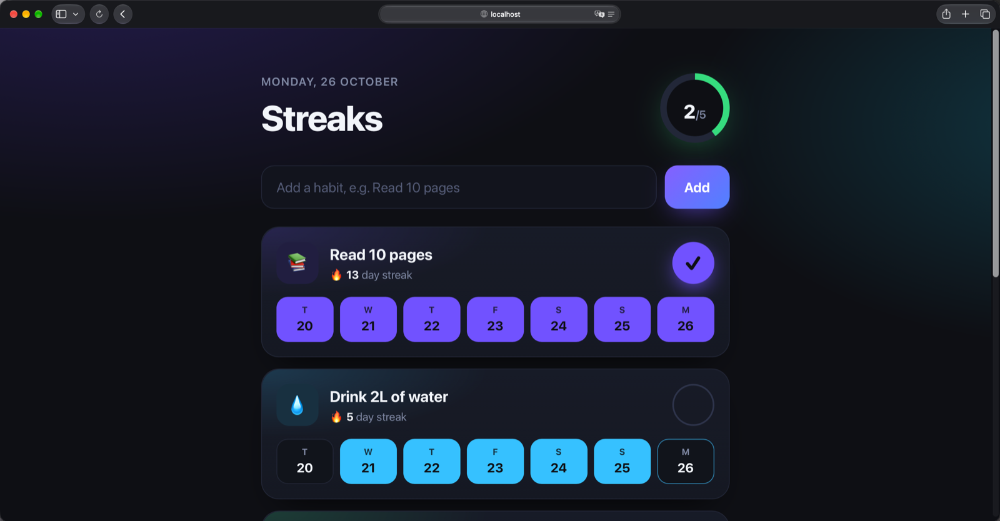

# Streaks: a web app in COBOL

A habit tracker web app written in COBOL, including the web server itself.
There's no Node, nginx or CGI wrapper in front of it. One GnuCOBOL program (~650 lines, comments included)
opens the socket, parses HTTP, routes requests, renders HTML and stores its data in
plain text files. There's no JavaScript either: every click is a plain form post.



📺 Video walkthrough: https://youtu.be/lbkTRdpedS0

## Run it

```bash
brew install gnucobol
cobc -x -free -fstatic-call habits.cbl -o habits
./habits
```

Then open http://localhost:8080. Run it from this folder: it reads `public/style.css`
and keeps its data in `data/`.

## How it works

| Part | COBOL |
|---|---|
| Networking | `CALL "socket"`, `"bind"`, `"listen"`, `"accept"`: libc called directly. The address is built byte by byte (`X"1F90"` is port 8080). |
| Concurrency | `CALL "fork"`: one process per connection, 1995-style. Browsers open idle connections in advance, which would block a single-process server. |
| HTTP parsing | `INSPECT ... TALLYING` finds the end of the headers, `UNSTRING` splits the request line. |
| Routing | `EVALUATE TRUE` / `WHEN HTTP-METHOD = "POST" AND REQ-PATH = "/add"` |
| HTML | `STRING ... DELIMITED BY SIZE INTO RESPONSE-BODY WITH POINTER BP`, with every habit name HTML-escaped. |
| Dates & streaks | `FUNCTION INTEGER-OF-DATE` / `DATE-OF-INTEGER` (days since 1601-01-01). Weekday is `MOD(day - 1, 7) + 1`. |
| Database | Two `LINE SEQUENTIAL` files with fixed-width records: `data/habits.dat` and `data/log.dat` (`HHHH` habit id + `YYYYMMDD`). |
| Emoji | A "very serious AI": eight `INSPECT ... TALLYING` keyword checks. |

## Limitations

This is a fun experiment, not production software.

- **macOS only:** the `sockaddr_in` layout and socket option numbers are macOS values.
  Linux needs small changes (no `sin_len` byte, different `SOL_SOCKET`/`SO_*` numbers).
- **Localhost only:** it listens on 127.0.0.1:8080. There's no TLS and no auth.
- **Fixed limits:** 100 habits and 5,000 check-ins, because COBOL tables have a fixed size.
- **Whole-file writes:** every change rewrites the data file. Two requests changing data at
  the same moment can overwrite each other.
- **Small requests only:** the request buffer is 16 KB.

## License

MIT
